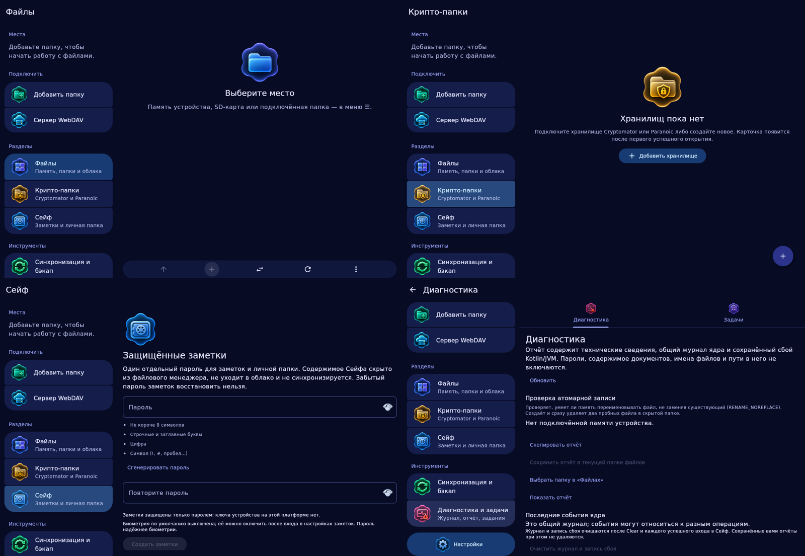

# Paranoic v2.1

Новая реализация защищённого файлового менеджера с нуля: Android + Windows.

## About (English)

**Paranoic** is an open-source, privacy-first file manager for **Android and Windows** with a Rust core and a Kotlin/Compose interface.

- Full file manager: storage, SD/USB, folders, categories (Downloads, Documents, Music, Videos, Pictures), search, trash, photo/video/audio and document viewer.
- Encrypted folders: **Cryptomator**-compatible vaults and its own **Paranoic** format; single files with **age**.
- **Safe**: notes and a personal folder behind one password, isolated from the file manager and the cloud, with biometrics, duress password and wipe.
- Archives (ZIP/AES, 7z) and a self-hosted server over WebDAV. Encrypted folders can be moved to any cloud by hand; no third-party cloud accounts are stored.
- Decrypted data never leaves the app. About 70% complete; `main` is the working, not-yet-stable code.

**Collaboration is welcome.** Anyone interested in privacy, Rust, Kotlin Multiplatform, cryptography or UI design — open an issue or a pull request, or just say hello. Always glad to meet people with the same interests.

## Сотрудничество

Приглашаю всех, кому интересен проект: приватность, Rust, Kotlin/Compose, криптография, дизайн. Пишите в issues, присылайте pull request'ы или просто знакомьтесь — всегда рад новым знакомым по интересам.

## Поддержать проект / Support

Донат в **BNB Smart Chain (BEP-20)**:

```
0x669dd60c8D6E45515600e5638563A2b6bBC7F998
```

Отправляйте только в сети BNB Smart Chain (BEP-20). / Send only on BNB Smart Chain (BEP-20).

**Карта проекта:** [ROADMAP.md](ROADMAP.md) — что есть, что работает, что дальше; проблемы и тесты — в [docs/roadmap](docs/roadmap/).



**Правила для исполнителей:** [AGENTS.md](AGENTS.md).

**Структура исходников:** [docs/REPOSITORY_LAYOUT.md](docs/REPOSITORY_LAYOUT.md).

## Рабочий принцип

- **Rust-first:** ядро, файловые операции, шифрование, архивы, документы и облачные адаптеры — Rust.
- **Интерфейс:** Kotlin Multiplatform + Compose (Material 3, тёмная тема и иконки владельца); связь с Rust через UniFFI (`crates/paranoic-bridge`).
- **Облако:** собственный сервер `paranoic-server` по WebDAV (подходит и Nextcloud). Google Drive / OneDrive / pCloud API не используются — решение владельца 25.11: зашифрованные папки переносятся в облако вручную.
- Все завершённые изменения сразу коммитятся в **main**. Скачать весь текущий код: GitHub → **Code → Download ZIP**.
- **main = актуальный код, а не гарантированная стабильная версия.** Проверки только по отдельной команде владельца после окончания крупного блока. Непроверенный код отмечается как непроверенный.
- Не копировать старые реализации и ограничения без необходимости; новую структуру развивать модульно.

## Текущее ядро

В Cargo workspace написаны `paranoic-core` (API, очередь, журнал SQLite,
восстановление), `paranoic-local` (доступ к native-каталогам через capability handles)
и `paranoic-crypto` (аутентифицированное шифрование, ключи, сессии).
Описание контрактов, подключения и ограничений: [Core API](crates/paranoic-core/README.md).
Кодовая часть 1.6 и границы её ответственности: [Crypto Engine](crates/paranoic-crypto/README.md).
В `paranoic-formats` (1.7) написаны [адаптеры age и Cryptomator (форматы 7/8)](crates/paranoic-formats/README.md) (VeraCrypt и AES Crypt удалены 2026-11-14).

Сборки: Android — `./gradlew :composeApp:assembleDebug` в `ui/`; Windows exe/MSI — workflow `windows-app.yml`.

**Состояние и планы** — только в [ROADMAP.md](ROADMAP.md); проблемы и тесты — [docs/roadmap](docs/roadmap/).

Проверка вручную (Linux): сначала `cargo build -p paranoic-server -p paranoic-documents --features paranoic-documents/pdf`, затем `cargo test --workspace --locked --features paranoic-documents/pdf -- --test-threads=1`.
Совместимость с Cryptomator: `tools/interop/` (Java, Maven) создаёт хранилища и
передаётся тестам через `PARANOIC_CRYPTOMATOR_FIXTURES` / `PARANOIC_CRYPTOMATOR_V7_FIXTURES`.

## Лицензия / License

© 2026 stratayun. Распространяется по лицензии **GNU AGPL-3.0-or-later** — см. [LICENSE](LICENSE).
Copyright © 2026 stratayun. Licensed under the **GNU Affero General Public License v3.0 or later** — see [LICENSE](LICENSE).
