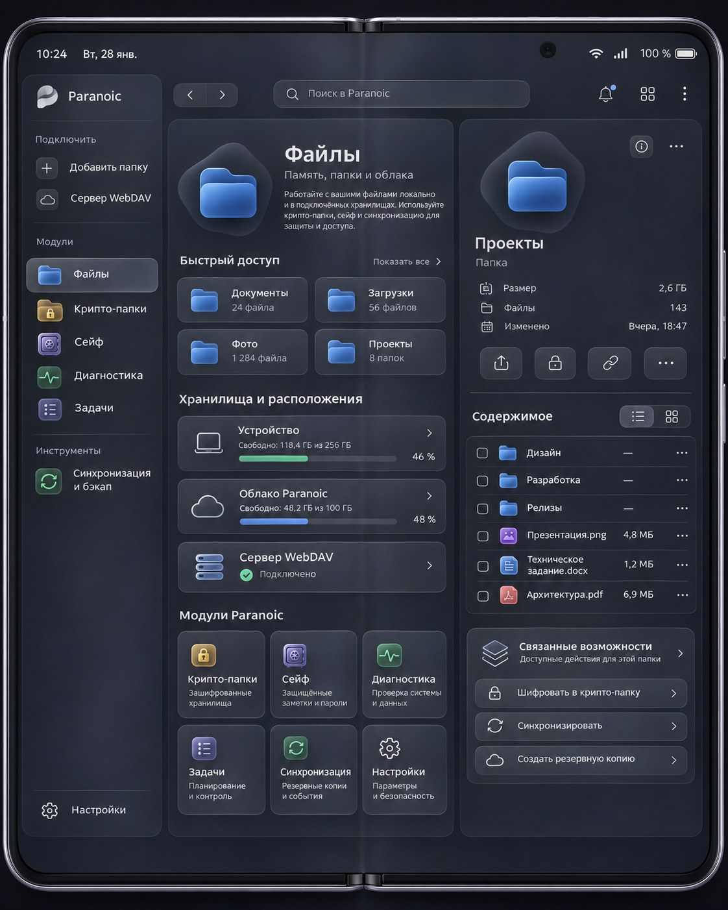
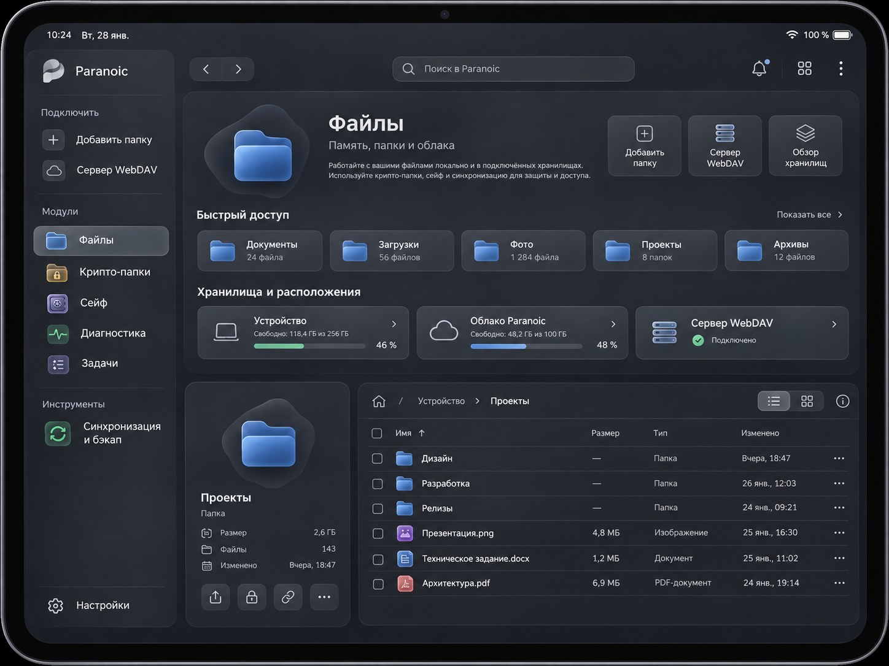
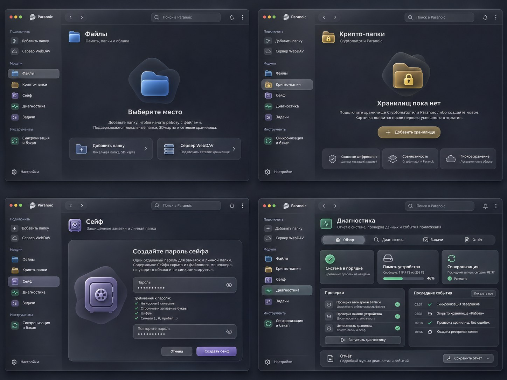
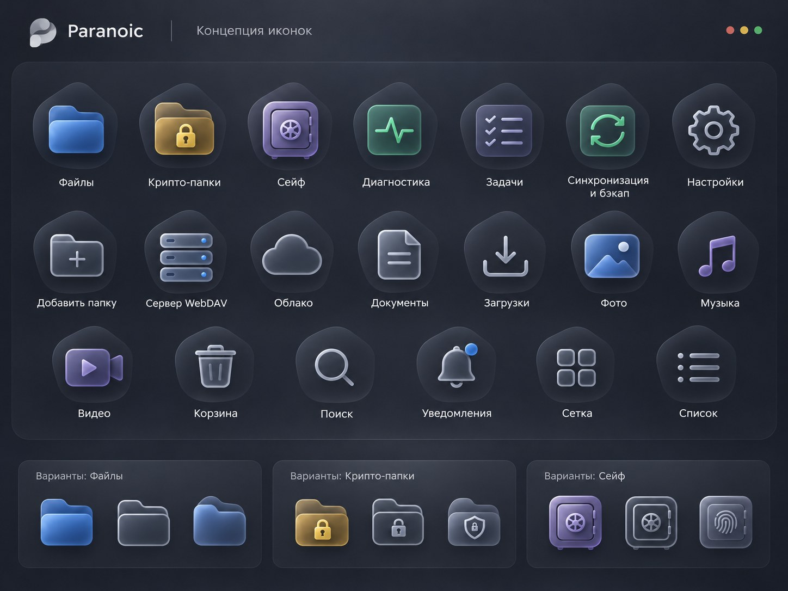

# Paranoic

**Paranoic** is an open-source, privacy-first file manager for **Android and Windows** (Linux planned) with a Rust core and a Kotlin/Compose interface.

- **Files:** internal storage, SD cards and USB drives, categories, search, tabs, pinned folders, trash, cleanup of duplicates and junk; viewer for photos, video, audio, PDF, Word, Excel, Markdown and text.
- **Encrypted folders:** **Cryptomator**-compatible vaults (formats 7/8) and the own **Paranoic** format; single files with **age**.
- **Safe:** notes and a personal folder behind one password, isolated from the file manager and the cloud; biometrics, duress password, auto-wipe, recovery key.
- **Archives:** ZIP (incl. AES) and 7z — browse, extract, create.
- **Own server:** `paranoic-server` over WebDAV (Nextcloud and other WebDAV servers work too). No third-party cloud accounts are stored; encrypted folders can be moved to any cloud by hand.
- Decrypted data never leaves the app; every file operation goes through a crash-safe journal.

`main` is the working code, not a stable release. Status: [ROADMAP.md](ROADMAP.md).

### Interface concept / Концепт интерфейса

Target look on phone, foldable, tablet and desktop. The phone layout and the icon pack are implemented; wide layouts are in progress.
Целевой вид на телефоне, складном, планшете и компьютере. Телефон и пак иконок уже в приложении, широкие экраны — в работе.

<p>
  
  
</p>
<p>
  
  
</p>
<p></p>

## Collaboration / Сотрудничество

Anyone interested in privacy, Rust, Kotlin Multiplatform, cryptography or UI design is welcome — open an issue or a pull request, or just say hello.

Приглашаю всех, кому интересен проект: приватность, Rust, Kotlin/Compose, криптография, дизайн. Пишите в issues, присылайте pull request'ы или просто знакомьтесь.

## Support / Поддержать

**BNB Smart Chain (BEP-20)** only:

```
0x669dd60c8D6E45515600e5638563A2b6bBC7F998
```

## Layout

| Path | What |
| --- | --- |
| `crates/paranoic-core` | Storage API, job queue, SQLite journal, crash recovery |
| `crates/paranoic-local` | Native folders and Android shared storage through capability handles |
| `crates/paranoic-crypto` | Authenticated encryption, keys, sessions, password tools |
| `crates/paranoic-formats` | age, Cryptomator 7/8, Paranoic vault ([format spec](docs/format/paranoic-v1.md)) |
| `crates/paranoic-documents` | Archives, PDF (isolated worker), Office, media decoding ([licenses](crates/paranoic-documents/ARCHIVE_LICENSES.md)) |
| `crates/paranoic-notes` | Safe: notes, duress password, password strength |
| `crates/paranoic-cloud`, `crates/paranoic-server` | WebDAV client, sync and backup; own WebDAV server |
| `crates/paranoic-windows` | Windows file primitives (no-replace rename, durable replace) |
| `crates/paranoic-bridge` | UniFFI API for Kotlin |
| `ui/` | Kotlin Multiplatform + Compose app (Android and Windows); icon pack in `ui/design/icons` |
| `tools/` | Native build, validation, Cryptomator interop fixtures |

## Build

- **Android APK:** in `ui/`, `./gradlew -Pparanoic.androidAbis=arm64-v8a :composeApp:assembleDebug` (Rust 1.89+, JDK 17, Android SDK 36 + NDK, `cargo-ndk`). Set `PARANOIC_KEYSTORE` and `PARANOIC_KEYSTORE_PASSWORD` to sign with the project key; otherwise a local debug key is used and the APK will not install over a project-signed copy.
- **Windows:** workflow `windows-app.yml` (portable folder and MSI), or `./gradlew :composeApp:createDistributable` on Windows.
- **Downloads:** workflow `distributions.yml` builds the APK and Windows portable and publishes them as a test release.
- **Rust tests:** `cargo test --workspace --locked --features paranoic-documents/pdf -- --test-threads=1`.

### Own server

```
paranoic-server token          # prints a new token for clients and its BLAKE3 hash
paranoic-server run config.json
```

```json
{ "root": "/srv/paranoic", "listen": "0.0.0.0:8443", "username": "me",
  "token_blake3": "<64 hex>", "tls_cert": "/etc/paranoic/cert.pem",
  "tls_key": "/etc/paranoic/key.pem", "read_only": false }
```

MOVE/COPY never replace an existing entry; DELETE goes to a hidden trash inside the root; only the token's hash is stored; TLS is required unless listening on loopback.

## License

Copyright © 2026 stratayun. Licensed under the **GNU Affero General Public License v3.0 or later** — see [LICENSE](LICENSE).
