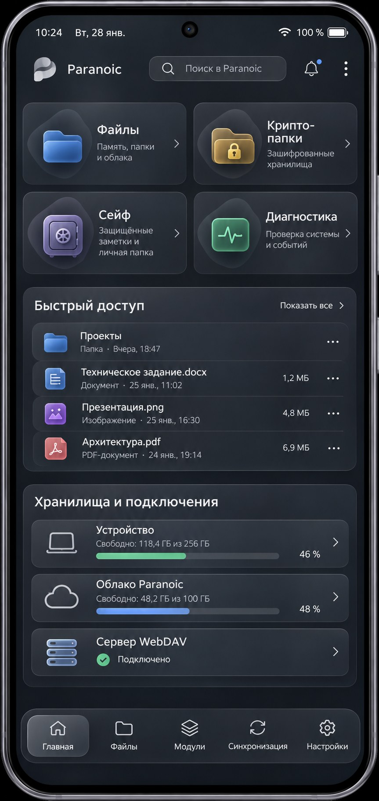

# Paranoic — карта

**Срез:** 28.11.2026, сборка `39243a0` (номер — Диагностика, строка `App:`). ✅ проверено владельцем на устройстве · 🟡 код есть, на устройстве не проверен.

## Что есть

- **Файлы** ✅ — память, SD, USB, копирование, перенос, корзина, поиск, сортировка, выделение, категории, Очистка, перенос в Сейф. 🟡 вкладки, закладки на папки, запуск со вставленной флешкой.
- **Документы** ✅ — текст, PDF, Word, Excel. 🟡 вид «лист бумаги», Markdown, масштаб 50–300 %.
- **Крипто-папки** ✅ — Cryptomator 7/8 и Paranoic (формат заморожен до внешнего аудита); age для файлов ✅, пачкой 🟡.
- **Сейф** ✅ — заметки и личная папка, автостирание. 🟡 биометрия, Clear, пароль под принуждением, ключ восстановления.
- **Архивы** 🟡 — ZIP/AES и 7z: просмотр, распаковка, сжатие.
- **Свой сервер** 🟡 — `paranoic-server` по WebDAV, синхронизация и бэкап.
- **Интерфейс** 🟡 — по концепту 27.11: Главная, Модули, нижние вкладки, меню мест, карточка памяти, единый пак из 58 иконок. Модули «Передача», «Подключения», «Терминал», «Уведомления» — кнопки «Скоро».
- **Платформы** — Android ✅; Windows 🟡 (portable запускается, функции не проверены); Linux — в плане.

## Дальше

Сначала функциональность и ядро. Ядро готово, когда сценарии проходят на Magic V5, A15 и Windows, а повторный аудит не находит серьёзного.

1. Проверка владельцем `39243a0`: флешка (запуск, переподключение), закладки, интерфейс в сложенном и разложенном виде.
2. Флешка без перезапуска приложения.
3. Доступ к файлам: кнопка в настройках, «нет доступа — разрешить» у мест.
4. Одинаковое поведение на Android, Windows, Linux: доступ к файлам, изолированный просмотр документов.
5. Windows: проход по функциям (создание хранилищ и MSI на устройстве не запускались).
6. Linux: ключ устройства (Secret Service), сборка, прогон сценариев.
7. Корзина в журнале Core (A06).
8. Секреты подписи в GitHub (`ANDROID_KEYSTORE_*`) — сборки из CI ставятся поверх.
9. Повторный аудит по частям на фиксированном коммите, затем релиз.
10. Интерфейс: правая колонка «подробности» на разложенном экране и планшете, навигация назад/вперёд на Windows.

## Аудиты

- **Код, 27.11** (53 замечания): исправлены, тесты Rust проходят; на устройствах не проверялось. Остатки: проверенная копия на Unix не удерживается от удаления чужим процессом (A32); корзина вне журнала Core (A06). Подробности — коммиты `1c15759`…
- **Криптография и утечки, 26.11:** серьёзных дыр нет; запись внутри хранилищ, откат 1.8 и синхронизация построчно не проверялись.

## Защита и ограничения

- Сборки для телефона без отладки; Android 14+ скрывает текст от чужих служб специальных возможностей; ключи Сейфа не работают на заблокированном телефоне; слабый пароль предлагается сменить.
- Флешки и SD-карты привязаны к пути тома: переподключение не ломает запуск; место с незавершёнными операциями откладывается, а не переносится.
- Ограничения: `lru` в WebDAV-сервере (небезопасен при панике); журнал на Windows без аппаратной привязки ключа; буфер Win+V может хранить скопированное; ключи могут попасть в файл подкачки; временные файлы — `%LOCALAPPDATA%\Paranoic\tmp`, очищаются при запуске и выходе (на Windows не проверено).

## Решения владельца

- Хранилища — Cryptomator и Paranoic; отдельные файлы — age. В крипто-папку файлы добавляются из неё самой; из разделов — в Сейф.
- Облако — только свой сервер и WebDAV.
- Android — прямой доступ к памяти, SD и USB; SAF убран; папки выбираются внутри приложения. Прямой USB (как в VaultExplorer) — не сейчас.
- Пароль — от 12 символов, длина важнее состава; забытый — только ключом восстановления. Пароль под принуждением защищает от беглого взгляда, не от экспертизы.
- Один ключ подписи APK для всех сборок.
- Платформы — Android, Windows, затем Linux; macOS не делаем.
- Интерфейс — концепт 27.11; тема «Сеть» не делаем. Быстрый доступ — закладки, не недавние файлы.
- Лицензия — AGPL-3.0-or-later, правообладатель stratayun.
